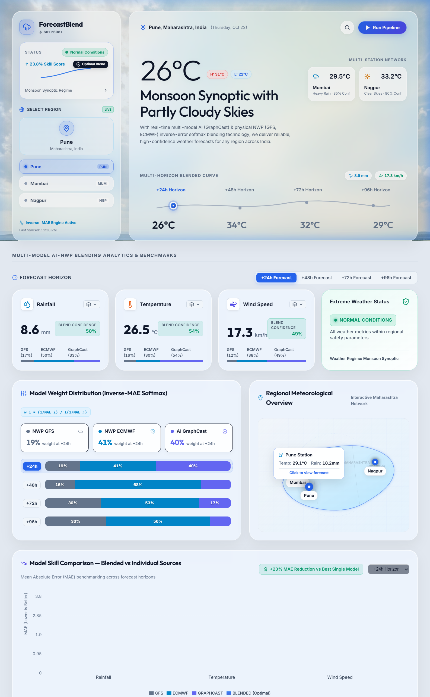
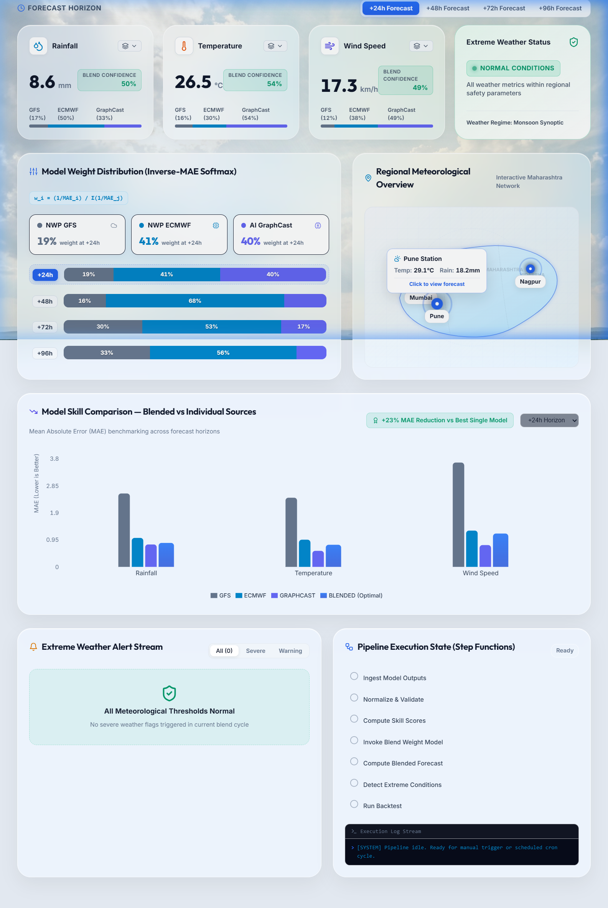
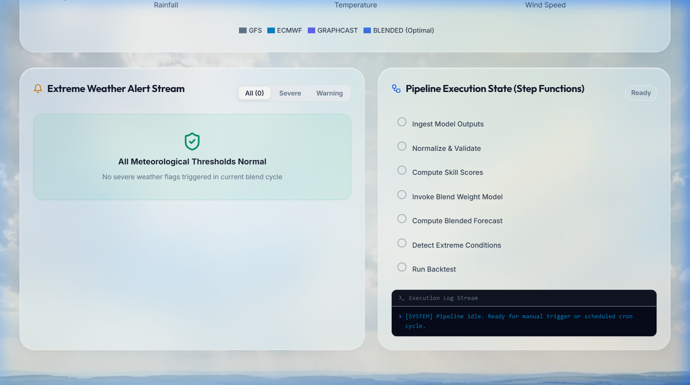
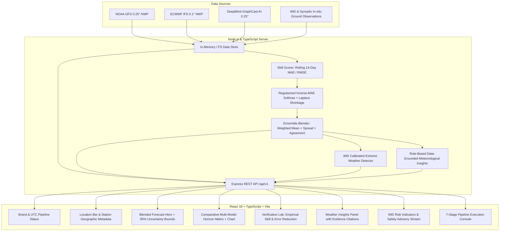

# ForecastBlend — Production-Ready Multi-Model Weather Intelligence Platform

[](https://github.com/Avadhut-Pawar31/ForecastBlend/actions/workflows/ci.yml)
[](https://forecast-blend.vercel.app)
[](https://www.typescriptlang.org/)
[](https://opensource.org/licenses/MIT)

> **ForecastBlend** is a meteorological intelligence and multi-model ensemble platform that ingests, normalizes, evaluates, and dynamically blends predictions from global numerical weather prediction (NWP) models and cutting-edge machine learning weather models. It answers three essential questions for operational meteorology and data-driven planning:
> 1. **What is the expected weather at my location?**
> 2. **How do competing forecast models disagree, and what does their synthesized blend indicate?**
> 3. **How reliable is the forecast, and what empirical verification evidence supports that assessment?**

---

## 🌐 Live Production Deployment

- **Interactive Dashboard:** [https://forecast-blend.vercel.app](https://forecast-blend.vercel.app)
- **Production Serverless API:** [https://forecast-blend.vercel.app/api/v1/forecast/PUN](https://forecast-blend.vercel.app/api/v1/forecast/PUN)
- **API Health Check:** [https://forecast-blend.vercel.app/api/v1/health](https://forecast-blend.vercel.app/api/v1/health)

---

## 📸 Dashboard Preview

| **Blended Forecast & Station Network** | **Multi-Model Horizon Comparison Matrix** |
|:---:|:---:|
|  |  |

| **Empirical Verification Lab & Skill Benchmarking** |
|:---:|
|  |

---

## 🏛️ System Architecture

ForecastBlend is designed with a strict, decoupled layered architecture separating raw weather ingestion, empirical skill verification, mathematical blending, and presentation.



---

## 📐 Scientific Blending Methodology

Rather than treating model consensus as an unweighted average or fabricating confidence scores, ForecastBlend implements a regularized inverse-error weighting scheme grounded in statistical ensemble forecasting.

### 1. Rolling Skill Evaluation (MAE)
For each model $m \in \mathcal{M}$, geographic region $r$, lead time $h \in \{24, 48, 72, 96\}$, variable $v$, and weather regime $\omega$:

$$\text{MAE}_{m, r, h, v, \omega} = \frac{1}{N} \sum_{k=1}^N \left| \hat{y}_{m, k} - y_{\text{obs}, k} \right|$$

where $N$ is the sample count over a rolling 14-day verification window. Lookahead bias is strictly prevented: observations evaluated were recorded strictly before the forecast issue time.

### 2. Regularized Inverse-MAE Softmax Weighting with Laplace Shrinkage
To prevent single-model overfitting and guard against division by zero, raw skill weights are computed using an epsilon regularizer $\epsilon = 0.05$:

$$S_m = \frac{1}{\text{MAE}_m + \epsilon}$$

Normalized initial probabilities:

$$p_m = \frac{S_m}{\sum_{j=1}^M S_j}$$

To prevent extreme weight swings when sample sizes are small or when an individual model experienced temporary anomalies, **Laplace Shrinkage** is applied toward a uniform uninformative prior ($1/M$):

$$\hat{w}_m = (1 - \lambda) \cdot p_m + \lambda \cdot \frac{1}{M}$$

where $\lambda = 0.15$. The resulting weights are strictly positive and satisfy:

$$\sum_{m \in \mathcal{M}} \hat{w}_m = 1.0$$

### 3. Blended Expected Value & Physical Bounds
$$\bar{y}_{\text{blend}} = \sum_{m \in \mathcal{M}} \hat{w}_m \cdot \hat{y}_m$$

Physical non-negativity constraints are strictly enforced:

$$\bar{y}_{\text{blend}} = \max\left(0, \bar{y}_{\text{blend}}\right) \quad \text{for } v \in \{\text{rainfall\_mm}, \text{wind\_kmh}\}$$

### 4. Ensemble Spread ($\sigma$) and Model Agreement Index ($A$)
Ensemble variance is calculated as the weighted sample dispersion:

$$\sigma = \sqrt{\sum_{m \in \mathcal{M}} \hat{w}_m \left(\hat{y}_m - \bar{y}_{\text{blend}}\right)^2}$$

The **Model Agreement Index** $A \in [0, 1]$ measures inter-model consensus relative to domain-specific dispersion scales $\sigma_{\text{ref}}$ (Rainfall: 8.0 mm, Temperature: 2.5 °C, Wind: 6.0 km/h):

$$A = \exp\left(-\frac{\sigma}{\sigma_{\text{ref}}}\right)$$

- $A \to 1.0$: Tight clustering between global models (high consensus).
- $A \to 0.0$: High inter-model divergence (synoptic uncertainty).

### 5. Statistical 95% Uncertainty Interval
Assuming an asymptotic normal error distribution around the ensemble mean:

$$I_{95\%} = \left[ \max\left(0, \bar{y}_{\text{blend}} - 1.96\sigma\right), \; \bar{y}_{\text{blend}} + 1.96\sigma \right]$$

---

## ⚠️ IMD-Calibrated Meteorological Indicators

ForecastBlend detects significant regional weather risks using official thresholds defined by the **India Meteorological Department (IMD)**:

| Category | Variable | Threshold | IMD Classification | Severity |
| :--- | :--- | :--- | :--- | :--- |
| **Precipitation** | `rainfall_mm` | $\ge 64.5\text{ mm / 24h}$ | Heavy Rainfall | Watch |
| **Precipitation** | `rainfall_mm` | $\ge 115.6\text{ mm / 24h}$ | Very Heavy Rainfall | Warning |
| **Precipitation** | `rainfall_mm` | $\ge 204.5\text{ mm / 24h}$ | Extremely Heavy Rainfall | Severe |
| **Heatwave** | `temp_c` | $\ge 40.0^\circ\text{C}$ | Heatwave Advisory | Watch |
| **Heatwave** | `temp_c` | $\ge 43.0^\circ\text{C}$ | Heatwave Condition | Warning |
| **Heatwave** | `temp_c` | $\ge 45.0^\circ\text{C}$ | Severe Heatwave Condition | Severe |
| **Gale Wind** | `wind_kmh` | $\ge 50.0\text{ km/h}$ | Gusty Wind Watch | Watch |
| **Gale Wind** | `wind_kmh` | $\ge 62.0\text{ km/h}$ | Gale Wind Warning | Warning |
| **Gale Wind** | `wind_kmh` | $\ge 88.0\text{ km/h}$ | Severe Gale Condition | Severe |

> **Safety Advisory Notice:** Indicators generated by ForecastBlend are rule-based decision support tools derived from numerical model blending and do not constitute official civil protection warnings. Always consult the [India Meteorological Department](https://mausam.imd.gov.in/) for official life and property safety directives.

---

## 🗺️ Meteorological Stations & Coverage

ForecastBlend monitors high-impact synoptic regions in Western and Central India:

| Station Code | City | Latitude | Longitude | Elevation | Climate Regime |
| :--- | :--- | :--- | :--- | :--- | :--- |
| **PUN** | Pune | 18.5204° N | 73.8567° E | 560 m | Semi-arid / Western Ghats Rain Shadow |
| **MUM** | Mumbai | 19.0760° N | 72.8777° E | 14 m | Tropical Wet & Dry / Coastal Maritime |
| **NGP** | Nagpur | 21.1458° N | 79.0882° E | 310 m | Tropical Wet & Dry / Central Continental |

---

## 🤖 Contributing Weather Models

ForecastBlend combines three structurally distinct forecasting paradigms:

1. **NOAA Global Forecast System (GFS)**
   - *Type:* Hydrostatic Primitive Equation Global NWP
   - *Resolution:* 0.25° (~22 km), 6-hour cycles (00Z, 06Z, 12Z, 18Z)
   - *Characteristics:* High skill at extended horizons (+72h to +96h); known orographic precipitation dispersion bias in steep coastal topography.
2. **ECMWF Integrated Forecasting System (IFS)**
   - *Type:* Non-hydrostatic Spectral Global NWP
   - *Resolution:* 0.1° (~9 km), 12-hour cycles (00Z, 12Z)
   - *Characteristics:* Gold-standard synoptic precipitation accuracy; conservative peak temperature estimations in convective regimes.
3. **DeepMind GraphCast AI Weather Model**
   - *Type:* Autoregressive Graph Neural Network (GNN) on Icosahedral Mesh
   - *Resolution:* 0.25° (~25 km), trained on 40 years of ECMWF ERA5 reanalysis
   - *Characteristics:* Extremely fast inference (<60s); superior mid-troposphere temperature tracking; smoother spatial precipitation gradients.

---

## ⚡ REST API Reference

All endpoints return JSON and include security headers (`X-Content-Type-Options: nosniff`, CORS enabled).

### 1. Multi-Model Blended Forecast
`GET /api/v1/forecast/:region`
```json
{
  "region": "PUN",
  "issued_at": "2026-10-22T06:00:00.000Z",
  "location": {
    "code": "PUN",
    "name": "Pune",
    "latitude": 18.5204,
    "longitude": 73.8567,
    "elevationM": 560,
    "climateZone": "Semi-arid / Western Ghats Rain Shadow"
  },
  "current_observation": {
    "region": "PUN",
    "observedAt": "2026-10-22T06:00:00.000Z",
    "temp_c": 28.5,
    "rainfall_mm": 0.0,
    "wind_kmh": 14.0,
    "source": "In-situ Synoptic Weather Station & Reanalysis Baseline"
  },
  "forecast": {
    "rainfall_mm": {
      "24": {
        "value": 14.2,
        "confidence": 0.782,
        "spread": 2.14,
        "uncertaintyRange": { "min": 10.01, "max": 18.39 },
        "weights": { "NWP_GFS": 0.28, "NWP_ECMWF": 0.44, "AI_GRAPHCAST": 0.28 },
        "models": { "NWP_GFS": 12.0, "NWP_ECMWF": 15.5, "AI_GRAPHCAST": 14.8 }
      }
    }
  }
}
```

### 2. Other Key Endpoints
| Method | Endpoint | Description |
| :--- | :--- | :--- |
| `GET` | `/api/v1/locations` | Returns all active meteorological stations with geographic metadata |
| `GET` | `/api/v1/alerts?region=MUM` | Returns active IMD-calibrated extreme weather indicators |
| `GET` | `/api/v1/insights/:region` | Rule-based meteorological insights with supporting model evidence |
| `GET` | `/api/v1/verification/:region`| Empirical 14-day rolling MAE/RMSE comparisons and error reduction % |
| `GET` | `/api/v1/weights/:region` | Active regularized model weights across horizons and weather regimes |
| `GET` | `/api/v1/health` | Service uptime, version, and operational health status |

---

## 🛠️ Local Development & Quickstart

### Prerequisites
- Node.js `18.x` or `20.x`
- npm `9.x` or later

### Installation
```bash
# Clone the repository
git clone https://github.com/Avadhut-Pawar31/ForecastBlend.git
cd ForecastBlend

# Install root, server, and dashboard dependencies
npm install

# Copy environment example
cp .env.example .env
```

### Running Locally
```bash
# Start both Dashboard (Vite) and Server (Express) concurrently:
npm run dev:server     # Runs server on http://localhost:3001
npm run dev:dashboard  # Runs dashboard on http://localhost:5173
```

### Running Tests & Production Build
```bash
# Execute Vitest test suite (Algorithms, Extreme Detector, API Integration)
npm test

# Build production bundles (TypeScript compilation & Vite bundle)
npm run build
```

---

## 🧪 Automated Testing Suite

ForecastBlend includes comprehensive unit and integration tests using [Vitest](https://vitest.dev/):
- **Weight Normalization & Shrinkage:** Validates that regularized weights strictly sum to 1.0, favor lower MAE models, and apply Laplace shrinkage toward equal priors on missing model data.
- **Blending & Bounds:** Validates weighted expectations, non-negative precipitation clamping, ensemble standard deviations, and Model Agreement Indices.
- **Extreme Event Detection:** Tests IMD thresholds for heavy rainfall, heatwaves, and gale winds with citations.
- **Data-Grounded Insights:** Verifies evidence generation from multi-model forecasts.
- **HTTP API Integration:** Tests status codes (200, 400, 404), JSON schema compliance, and parameter validation.

Run tests anytime with:
```bash
npm --prefix server run test
```

---

## 📄 License

This project is licensed under the [MIT License](LICENSE) — see the `LICENSE` file for details.

Developed with passion for open meteorological science and reliable weather intelligence.
